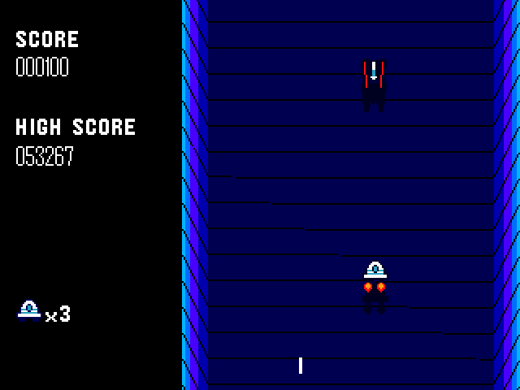

# ship
Some cruddy space shooter I made for the TI 84 Plus CE, with the CE C Toolchain. Was quite a bit popular at school tho

  

It's **absurdly** basic. I suppose a five year old could beat it in basicness. You just shoot the same enemy ship for eternity to rack up the high score. Yes there's only **one enemy ship** on screen at a time. He's pretty dumb and shoots hoping you'd get hit. He can also do a Galaxian-home at ya so you have to evade it. But that makes shooting him easier
If you die you don't respawn right away. To deploy a new ship press 2nd right away, which can also make use for a good strategy

Bonus ship every 5000 points

# Controls

Moving left and right: **Sike you're smart enough to know yourself**

Shoot: **2nd**

Deploy new ship after old one "died": **2nd**

Quit: **clear**

# How to ACTUALLY play it tho
If you try to play it on a stock CE there's a good chance an error would pop up.

Unless you're below OS 5.5.5 TI decided to get rid of machine language program support, yes including programs written in C. You need the ArTIfiCE jailbreak. But even then the game was made using the CE C Toolchain and makes use of specialized standard libraries such as graphx and keypadc so you need clibs or LibLoad as well. Have both and you're good to go
